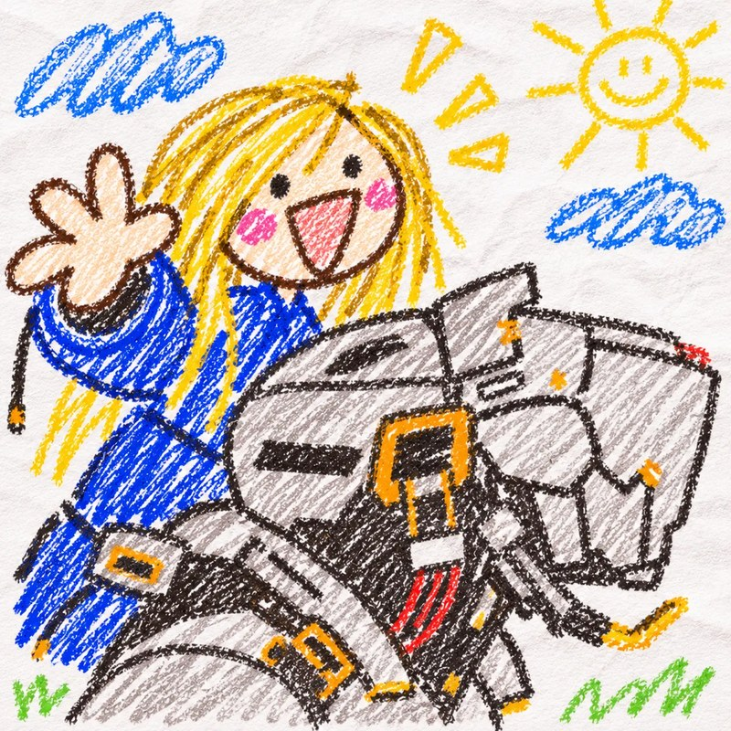

<p align="center">
  
</p>

<h1 align="center">Guy with a Kid on His Back</h1>

<p align="center">
  <b>PRAGMATA (Nintendo Switch 2), running natively on an iPhone</b><br>
  a two-person port by <a href="https://github.com/cheemu21">cheemu21</a> and <a href="https://github.com/huzaifahshahid71-ops">huzaifahshahid71-ops</a>, built on <a href="https://github.com/seedds">seedds</a>' <a href="https://github.com/seedds/nxnative">nxnative</a>
</p>

<p align="center">
  
  
  
  
  <a href="LICENSE"></a>
</p>

<p align="center">
  <a href="#latest-v25">Latest</a> ·
  <a href="#where-it-stands">Where it stands</a> ·
  <a href="#the-road-so-far-v1-v25">The road so far</a> ·
  <a href="#requirements">Requirements</a> ·
  <a href="#build">Build</a> ·
  <a href="#install-and-play">Install and play</a> ·
  <a href="#the-launcher">The launcher</a> ·
  <a href="#known-issues">Known issues</a> ·
  <a href="#credits">Credits</a>
</p>

Hi! This is our attempt to get PRAGMATA, Hugh and Diana's trip across the Moon, running on an iPhone as a real app. [huzaifahshahid71-ops](https://github.com/huzaifahshahid71-ops) started it with the [PRAGMATA iOS investigation](https://github.com/huzaifahshahid71-ops/pragmata-ios-investigation); [cheemu21](https://github.com/cheemu21) carried it from there through V1–V25. It isn't an emulator: the game's own code runs directly on the Apple chip, and its graphics are rebuilt on Apple's Metal 4. The name is the game in one line: a guy with a kid on his back.

> [!NOTE]
> **Nothing from the game is in this repository.** You build the app yourself from your own copy of PRAGMATA. This project is not affiliated with the game's creators or with Nintendo.

> [!WARNING]
> **Work in progress.** PRAGMATA runs on an iPhone 18 Pro through the opening and into play, but it is not stable for long sessions yet, and it does not run on 8 GB devices yet. See [Where it stands](#where-it-stands).

## Latest: V25

- **A new launcher made for PRAGMATA:** the Earth rising over the Moon behind it, a board of six setting nodes, and PLAY as a diamond in the corner. See [The launcher](#the-launcher).
- **Every memory saver is a switch now:** the Texture saver, freeing unused render targets and idle upload memory, and the size frame generation works at. Before V25 they could only be set in `env.txt`.
- **The Performance HUD is a toggle again:** a line in `env.txt` used to lock it.
- Everything from V24: the texture memory saver (large textures skip their finest detail levels, for far less GPU memory).

## Where it stands

Measured on cheemu21's **iPhone 18 Pro** (A20 Pro), iOS 27.2:

- **Title screen and menus:** 60 fps.
- **Gameplay:** 30 fps with frame generation on, so 60 fps on screen; frame times steady at 33 ms.
- **Longest runs:** 6–7 minutes of play with no GPU error (V20, V22), each ended by leaving the app.
- **GPU memory in play:** 5.7–6.6 GB resident before the texture saver (V22), inside the 18 Pro's 8 GB budget.
- **GPU time:** about 25 ms a frame in play plus 3.5 ms for frame generation, of a 33 ms budget.

**Where we're headed:** 8 GB devices (iPhone 15 Pro class). Their GPU budget is about 5.4 GB and their GPU is slower, so the plan is the lowest memory and the least work per frame the game will take. V24 and V25 are the first steps.

## The road so far (V1–V25)

| Build | What changed |
|---|---|
| V1 | The first build: the game boots on the iPhone |
| V2 | A 30 / 60 fps option |
| V3 | The game's log written on the device |
| V4 | A sparse-texture memory fix and the "Orbit" touch controls, made around PRAGMATA's aiming and hacking |
| V5 | Rebased on upstream nxnative, with PRAGMATA-styled controls |
| V6 | Compute image ranges and dual-source blend shaders |
| V7–V8 | One-pass texture clears; touch-control fixes (V7 crashed at Play, V8 fixed it) |
| V9 | Single-level sparse textures tiled |
| V10–V12 | Frame generation (the game draws 30, MetalFX makes the frame between), then paced by the present interval |
| V13–V18 | The big memory pools: old copies released once the GPU is done, small tail buffers instead of whole-pool copies, the residency commit worker |
| V19 | Shared render targets nobody used for a while released |
| V20 | Fixed streamed models showing up invisible; a memory census in the log |
| V21 | Fixed a freeze that could take the whole phone down (guest-file pages wired before the residency commit) |
| V22 | Shader-code memory kept out of the GPU's memory; idle upload memory given back |
| V23 | The Ocarina of Time port's touch stick and a 30 % bigger D-pad |
| V24 | The texture memory saver |
| V25 | The PRAGMATA launcher; the memory savers and the Performance HUD as launcher switches |

## Features

**Memory** (the main blocker on iPhone)

- **Texture saver:** large compressed textures are made without their finest detail levels, a little softer up close for much less GPU memory.
- Large memory pools are wired only as far as the game reads them, and their old copies are released once the GPU is done with them.
- A lookup of unknown length near the end of a growing pool takes a small buffer to the pool's end instead of a copy of the whole pool (the opening's crashes, V14–V17).
- Shared render targets nothing has used for a while are released (20 seconds by default on the iPhone).
- Shader-code pools stay out of the GPU's memory (the GPU never reads them).
- Idle upload staging is given back after 3 seconds.
- A memory census in the log every 1,800 frames: what holds the GPU's memory, by kind.

**Stability**

- Guest-file pages are wired before the residency commit, so the GPU driver never pages the game's memory files in itself; that froze the game and once panicked the phone.
- The residency commit runs off the GPU completion queue, so one slow commit cannot hold up every finished frame.

**Performance and presentation**

- Frame generation: the game draws 30 frames a second and MetalFX's frame interpolator makes the one between each two (about 3.5 ms each), at half size by default.
- One-pass layered texture clears (a 3D texture was cleared in 128 passes every frame), reused sparse-texture gather buffers.

**Touch controls ("Orbit")**

- ZL locks on with a tap and is held with a long press; a large second fire key appears at the top left while aiming.
- Near-white highlights, the stick in the Ocarina of Time port's style, a large D-pad with arrowheads.

## Requirements

- **Your own copy of PRAGMATA:** a `.nup` holding update v196608 (no base game or DLC needed).
- **A Mac with Apple silicon**, Xcode 27.2 or later, and Python 3.14 or later (reading a `.nup` needs `compression.zstd`). The first build compiles every shader and needs a lot of disk space (about 43 GB beyond the dump, about 2 hours on an M5).
- **An iPhone with 12 GB of memory or more for now** (tested: iPhone 18 Pro), iOS 27 or later, and a way to run an unsigned IPA (tested with LiveContainer / Strata).

## Build

```sh
git clone https://github.com/cheemu21/guy-with-a-kid-on-his-back.git
cd guy-with-a-kid-on-his-back
python3 scripts/build_ipa_from_nsp.py "/path/to/your dump.nup" --platform ios --romfs separate
```

The build writes an unsigned IPA. The game files are not inside it: copy them to the phone once, with the app installed, using the command the build prints at the end:

```sh
scripts/push_romfs.sh <device UDID> org.nxnative.0400c76024710000 "<build folder>/extract/v196608/RomFS.img"
```

Later builds reuse the extracted game files and the compiled shaders, and take about 3 minutes.

## Install and play

1. Install the IPA in LiveContainer (tested with Strata: Apps → **+** → Install IPA File). When asked about an existing app with the same bundle ID, replace it to keep your saves.
2. The game needs a large address space. Put this in the app's `Documents/env.txt`:

   ```
   DM_ALIAS_SIZE=0xC00000000
   ```

   Leave the launcher's settings out of `env.txt`: anything set there is locked in the launcher ("Set by an env file").
3. Start PRAGMATA, pick your settings and press PLAY.

## The launcher

<p align="center"><i>The Earth over the Moon behind it, PRAGMATA at the top left, the settings as a board of nodes, PLAY at the bottom right.</i></p>

- **The board:** six nodes, tap one to change it: **Frame Rate**, **Frame Gen**, **Console** (Docked / Handheld), **Tex Saver**, **Perf HUD** and **Controls** (Orbit, Orbit + D-pad, or Tap in handheld mode). A lit node is on; the panel at the right says what the last one you tapped does.
- **PLAY:** checks your cloud save first (when you use one) and asks if this iPhone's save and the cloud's both changed.
- **ALL SETTINGS:** every setting as a card, with the touch layout, cloud saves, the memory available and Reset to tested defaults.

**Best settings on an 18 Pro:** Frame rate 30 with Frame generation on (60 fps on screen; native 60 in play is out of reach on the GPU's budget), Handheld console mode (lower 3D resolution), Texture saver on.

**Diagnostics** go in `Documents/env.txt`: `DM_MEMSTAT=memstat.tsv` writes memory by region once a second; `DM_NVN_GPUPROF=every:1800` times every GPU pass in one frame a minute.

## Known issues

- **GPU memory** is above the budget of 8 GB devices; long sessions on the 18 Pro may still run out.
- **After a GPU hang** the game can go on at about one frame a second instead of recovering.
- **A GPU address fault at the title movie** happens now and then; the game recovers from it.
- **Some tessellated draws are not replayed**, so a few pieces of geometry may be missing.
- **Heavy streaming** on the way into play can stutter (frames of 50–67 ms).

## Credits

- **[huzaifahshahid71-ops](https://github.com/huzaifahshahid71-ops)** — the [PRAGMATA iOS investigation](https://github.com/huzaifahshahid71-ops/pragmata-ios-investigation) this port started from: the pinned nxnative changes, diagnostic tools and investigation notes it was handed over as.
- **[seedds/nxnative](https://github.com/seedds/nxnative)** and its contributors — the native runtime, the Metal 4 graphics and upstream's PRAGMATA support this is built on. Upstream fixes ported here include work by [stan69b](https://github.com/stan69b) (guest-file wiring, shader-code pools, render-target heap slack, from PRs #1971 and #2566), [oliverames](https://github.com/oliverames) and kencalx's [NX18](https://github.com/kencalx/NX18) (the residency commit worker, PR #2868), [eibrunocorrea](https://github.com/eibrunocorrea) (indirect-draw masks, PR #2945), [aksmith-git](https://github.com/aksmith-git) (idle upload staging, PR #1491) and the texture memory saver (PR #1418).
- **[Kid with Sword Remake](https://github.com/cheemu21/kid-with-sword-remake)** (cheemu21's Ocarina of Time port) — frame generation and the touch stick's design.
- The crayon drawing at the top and the launcher's Earth-over-the-Moon picture are fan art.

Upstream source and its modifications keep the upstream MIT notice in [LICENSE](LICENSE). nxnative's own documentation (other games, the Mac app, developer notes) is in [docs](docs) and [dm/games](dm/games/README.md).
